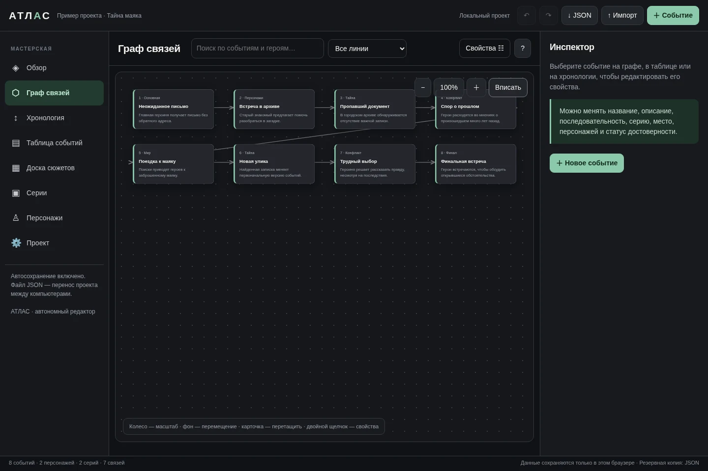
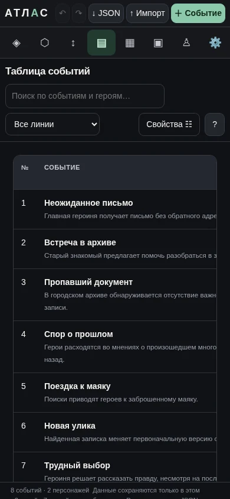

# АТЛАС — сценарная мастерская

Автономный визуальный редактор для разработки сериалов, фильмов и книг. Работает без регистрации, сервера, установки и сторонних библиотек.

[**Открыть демо**](https://vremennobeznika.github.io/atlas-story-editor/) · HTML / CSS / JavaScript · без сборки и внешних зависимостей

## Скриншоты

  
  

Снимки реального приложения с вымышленным примером «Тайна маяка».

## Попробовать за минуту

1. Откройте демо и выберите «Граф связей» → «Вписать».
2. Выберите событие и измените его название в свойствах.
3. Нажмите «↓ JSON», чтобы сохранить резервную копию.

## Запуск

[Открыть редактор](https://vremennobeznika.github.io/atlas-story-editor/) или скачать `index.html` и открыть в браузере. Встроенная «Тайна маяка» — полностью вымышленный учебный сюжет, не содержащий реальной истории автора.

## Возможности

- Интерактивный граф событий с направленными связями.
- Хронология, таблица и поиск по событиям.
- Карточки персонажей, сюжетные линии, планирование серий.
- Отмена и повтор изменений.
- Автосохранение в браузере, импорт и экспорт JSON.

## Конфиденциальность

Данные проекта сохраняются только в localStorage браузера и не отправляются на сервер. Публичная версия использует отдельный ключ хранилища `atlas-public-demo-v2` и не загружает проекты прежней версии. Не добавляйте в публичный репозиторий экспортированные JSON с личными данными.

## Ограничения

При очистке данных браузера проект может быть утрачен: регулярно экспортируйте JSON. Импорт проекта заменяет текущие данные, поэтому перед импортом сохраните резервную копию. Синхронизация между устройствами и совместное редактирование не предусмотрены.

## Проверка

Проверены в Chromium: запуск редактора, граф из восьми демонстрационных событий, перемещение карточки, отмена, таблица, экспорт JSON и отсутствие ошибок JavaScript при этих действиях. Длительная работа на старых устройствах не проверена.

### Проверка оформления 26.10.2026

В Chromium через localhost проверены обзор, граф и таблица на ширинах 320, 390 и 1440 CSS-px. Исправлен выход шапки за ширину мобильного экрана; ошибок JavaScript при этих переходах не обнаружено. Скриншоты сняты на 1440 × 960 и 390 × 844. Проверка не охватывает реальные Safari/iOS и не подтверждает все функции редактора.
