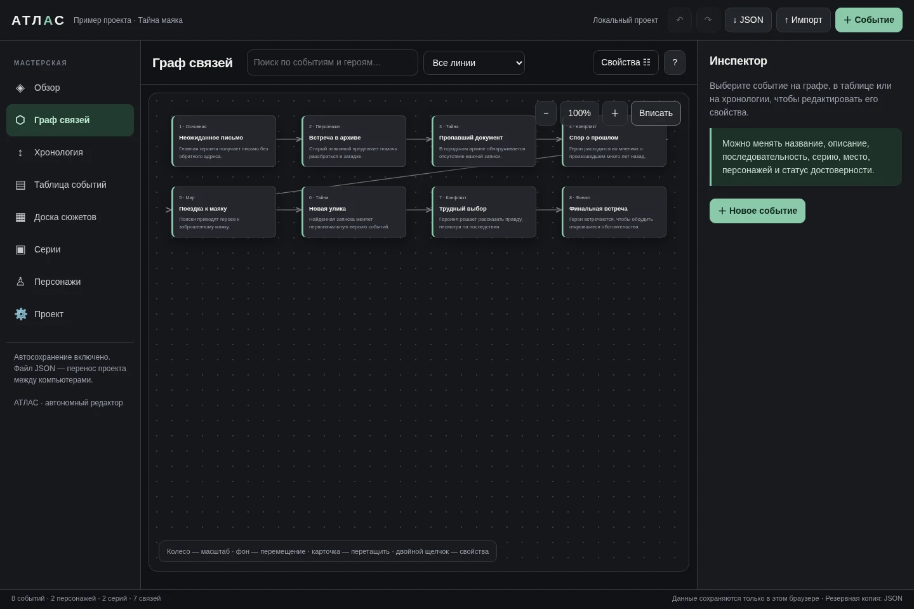
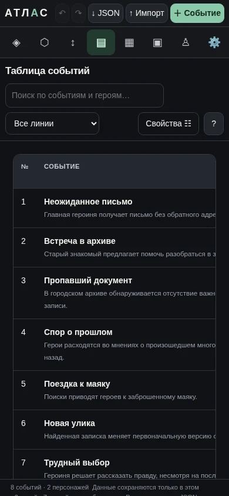
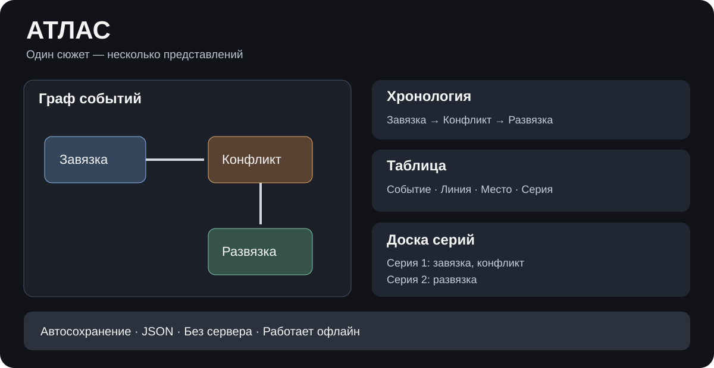

# АТЛАС — сценарная мастерская

Автономный визуальный редактор для разработки сериалов, фильмов и книг. Работает без регистрации, сервера, установки и сторонних библиотек.

[**Открыть демо**](https://vremennobeznika.github.io/atlas-story-editor/) · HTML / CSS / JavaScript · без сборки и внешних зависимостей

## Скриншоты

  
  

Снимки реального приложения с вымышленным примером «Тайна маяка».

## Попробовать за минуту

1. Откройте демо и выберите «Граф связей» → «Вписать».
2. Выберите событие и измените его название в свойствах.
3. Нажмите «↓ JSON», чтобы сохранить резервную копию.

## Запуск

[Открыть редактор](https://vremennobeznika.github.io/atlas-story-editor/) или скачать `index.html` и открыть в браузере. Встроенная «Тайна маяка» — полностью вымышленный учебный сюжет, не содержащий реальной истории автора.

## Возможности

- Интерактивный граф событий с направленными связями.
- Хронология, таблица и поиск по событиям.
- Карточки персонажей, сюжетные линии, планирование серий.
- Отмена и повтор изменений.
- Автосохранение в браузере, импорт и экспорт JSON.

## Конфиденциальность

Данные проекта сохраняются только в localStorage браузера и не отправляются на сервер. Публичная версия использует отдельный ключ хранилища `atlas-public-demo-v2` и не загружает проекты прежней версии. Не добавляйте в публичный репозиторий экспортированные JSON с личными данными.

## Ограничения

При очистке данных браузера проект может быть утрачен: регулярно экспортируйте JSON. Импорт проекта заменяет текущие данные, поэтому перед импортом сохраните резервную копию. Синхронизация между устройствами и совместное редактирование не предусмотрены.

## Проверка качества

### Ревизия 20.11.2026

Устранены несоответствия сюжетных линий и фильтра, несовместимость копирования события со старыми браузерами (использование `structuredClone`), отсутствие на доске некоторых групп, перезапись пользовательского статуса при редактировании и конфликт одинаковых названий серий. Исправлено переопределение адаптивных отступов. Добавлены заметная клавиатурная фокусировка, подписи поиска/фильтра и более строгие проверки импортируемых проектов.

**Фактически выполнено:** синтаксический разбор встроенного JavaScript; 12 функциональных проверок в изолированном JavaScript-окружении с имитацией DOM, FileReader и localStorage. Проверены демонстрационные события, экранирование HTML, добавление/отмена/повтор изменения, локальная запись, корректный импорт и отклонение пяти классов повреждённых данных, отказ на JSON `null` и вызов рендеринга. **12/12 пройдено.** После внесения правок файл повторно прочитан из GitHub.

**Автоматизация:** добавлены `tests/browser-qa.cjs` и `.github/workflows/browser-qa.yml`: Chromium E2E запускается на каждом push в `main`, в pull request и вручную через GitHub Actions. Наличие сценария не означает, что его первое выполнение уже прошло успешно.

**Не подтверждено этой ревизией:** полноценный браузерный E2E, фактический UI в Safari/Firefox/на телефоне, производительность, нагрузка, поведение при переполнении хранилища и результат публикации GitHub Pages. Отсутствие статусов CI для коммита не означает успешную проверку CI. Вердикт по полной матрице выпуска — **не готово к безусловной приёмке**, хотя точечные исправления внесены.

### Исторические испытания 26.10.2026

В Chromium через localhost проверялись обзор, граф и таблица на ширинах 320, 390 и 1440 CSS-px. Проверялись запуск, восемь демонстрационных событий, перетаскивание карточки, отмена, таблица и экспорт JSON. Исправлялся выход шапки за мобильную ширину. Скриншоты снимались на 1440 × 960 и 390 × 844. **Эти испытания относятся к состоянию кода на 26.10.2026 и не подтверждают текущую редакцию.** Реальные Safari/iOS тогда не испытывались.

## Эксплуатационные особенности

- Выбранное событие редактируется в инспекторе; поля применяются нажатием «Сохранить». Автосохранение относится к **уже применённым** изменениям.
- Сюжетная линия и статус, пришедшие из корректного импортированного проекта, сохраняются при открытии инспектора.
- Импорт принимает JSON размером не более 10 МБ; лимиты структуры: до 5000 событий, 2000 персонажей, 20 000 связей и 1000 серий. Проверяются идентификаторы, связи объектов, уникальность названий серий и координаты.
- Отмена/повтор хранятся только в памяти открытой страницы, не переносятся в JSON и сбрасываются при обновлении страницы.
- Для резервного копирования и переноса между устройствами используйте экспорт JSON. Автоматической синхронизации и облачного резервирования нет.
